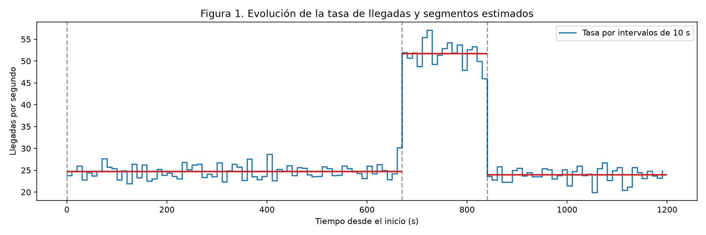
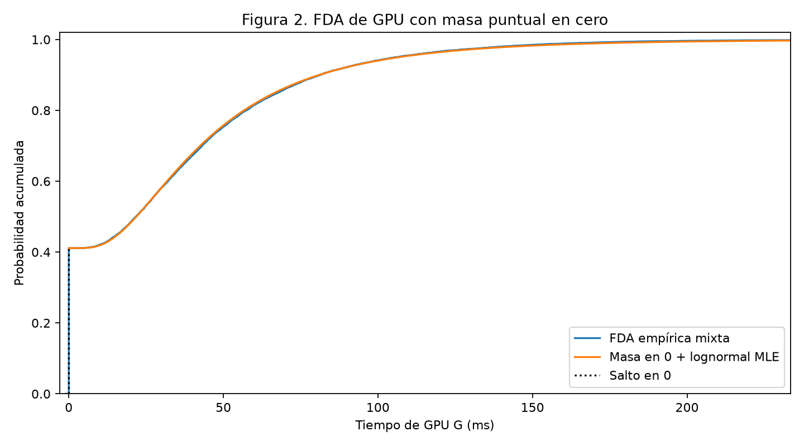
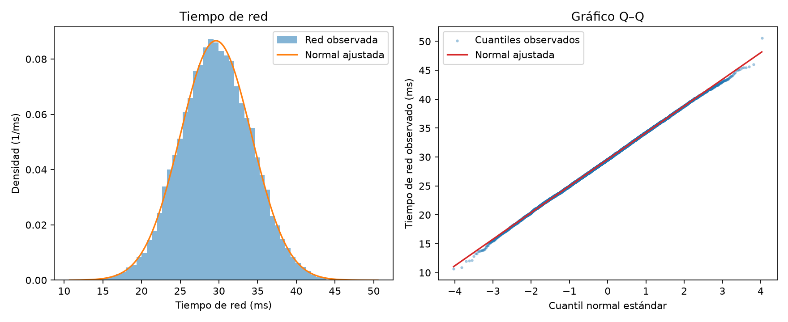
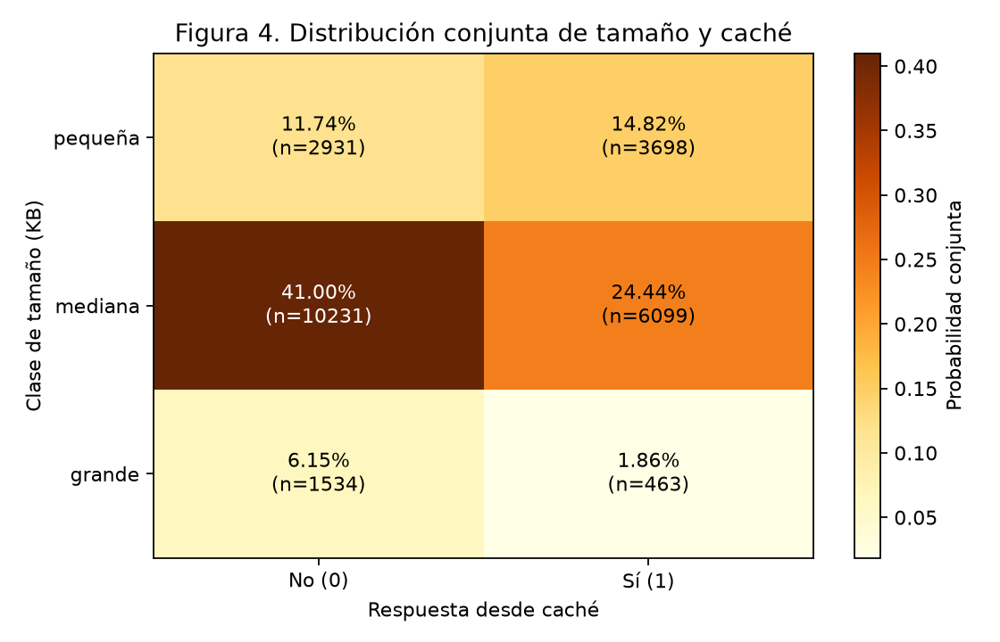
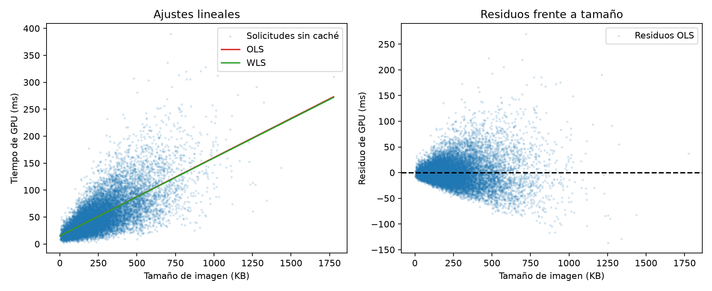
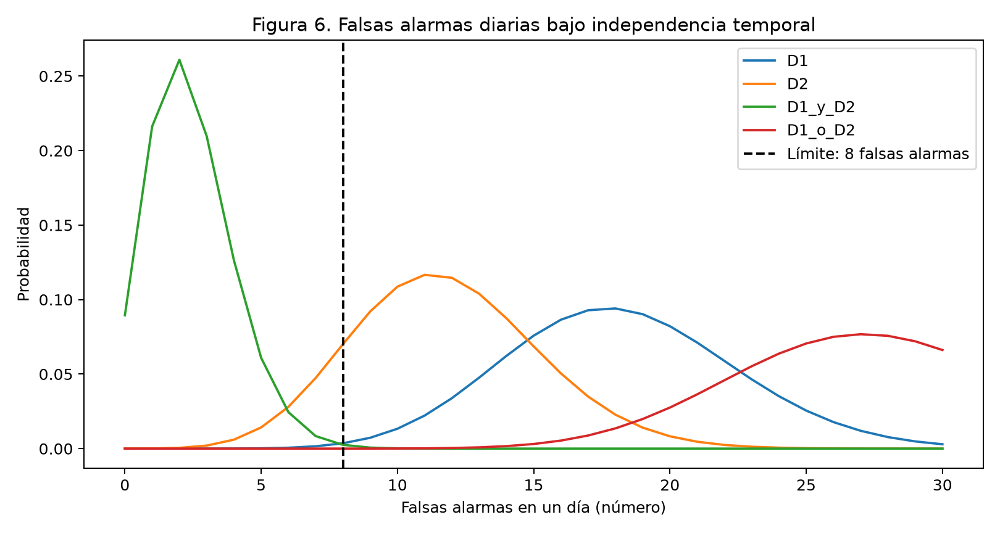
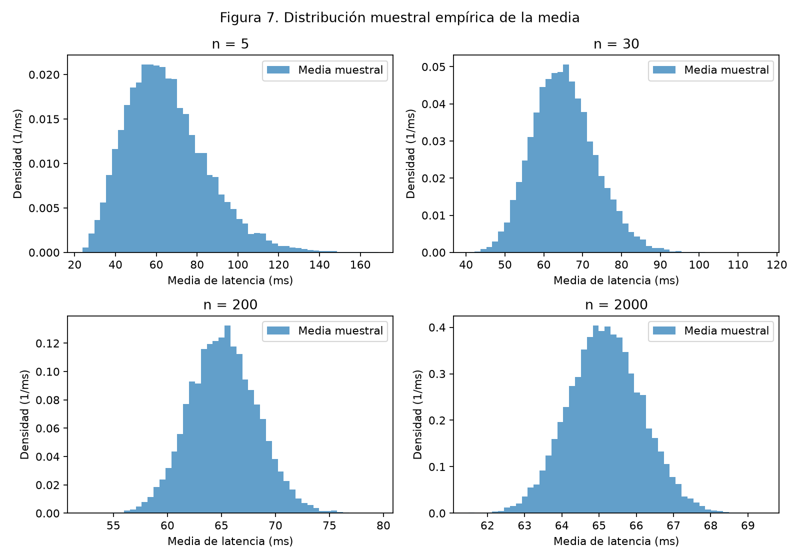
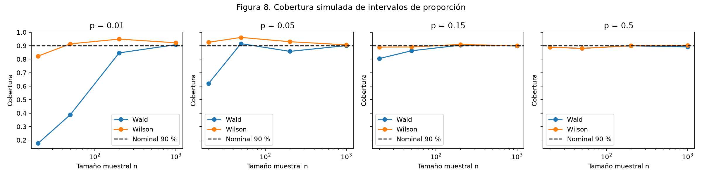
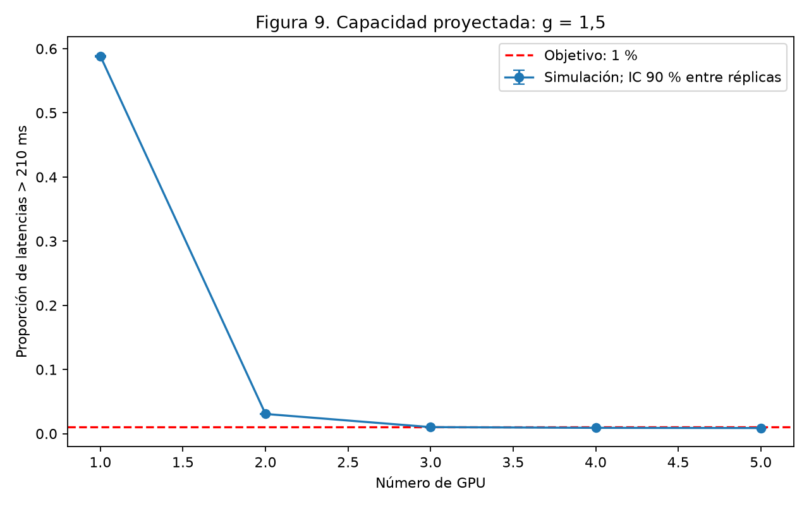

# Informe técnico — confiabilidad y capacidad de inferencia

**BORRADOR PARA REVISIÓN DEL GRUPO — no entregar sin completar las deducciones manuscritas y revisar los supuestos y las limitaciones indicadas.**

Grupo: C1 = 1023092749; C2 = 1023092750; semilla S = 2046185499. Nivel de confianza 90 %, umbral de latencia τ = 210 ms, tolerancia ε = 0,01, crecimiento g = 1,5, clases de tamaño 120 y 500 KB. El notebook y las tablas `outputs/<punto>/` constituyen la trazabilidad computacional. Las cifras se redondean solo para exposición.

## A. Auditoría, régimen y descripción

**A1.** De 34.072 filas se convierten 50 tamaños identificados en bytes a KB y se eliminan 101 duplicados tras la conversión. Además se excluyen 234 filas con latencia o componentes inválidos o faltantes, quedando 33.737. Algunas categorías de exclusión pueden superponerse; no se deben sumar sus conteos como si fueran disjuntas. La condición física se evalúa con tolerancia de 0,015001 ms por redondeo. Fuente: `outputs/A1/resumen_auditoria.csv` y filas auditadas/excluidas.

**A2.** Se usa como régimen estable [0, 668) ∪ [838, 1200] s: 24.956 solicitudes, 1.030 s de exposición; el intervalo intermedio contiene 8.781 solicitudes. Las comparaciones entre tramos externos producen KS de intervalos D = 0,01421, p = 0,20328 y KS de latencia D = 0,00747, p = 0,90929. No rechazar una diferencia no demuestra identidad ni estacionariedad. El criterio BIC conserva los cortes adicionales que aparecen con agregación gruesa. Fuente: `outputs/A2/` y Figura 1.

**A3.** Los resúmenes por tramo y versión están en `outputs/A3/resumen_descriptivo.csv`: se usa varianza muestral con divisor n−1, asimetría corregida y exceso de curtosis corregido. Los intervalos entre llegadas se calculan por separado en los dos tramos para no introducir un salto artificial.

## B. Llegadas y reintentos

**B1.** La tasa de filas válidas estables es 24,229 solicitudes/s, IC de Poisson al 90 % [23,977; 24,483]. El ajuste presupone un proceso Poisson homogéneo; las pruebas disponibles no prueban independencia. El conteo se refiere a solicitudes registradas, no establece si cada reintento genera otra llegada. **B2.** En bloques de 100 la media de solicitudes con reintentos es 15,30 en estabilidad y 31,28 en el incidente.

**B3.** Bajo el modelo de intentos y censura documentado en el notebook, la probabilidad estimada de fallo por intento es 0,15330 y el intervalo de perfil al 90 % es [0,14987; 0,15678]. La deducción debe ser manuscrita por el grupo. **B4.** El cálculo analítico produce 0,28016 y Monte Carlo 0,27857, IC de simulación [0,27692; 0,28022]. El intervalo Monte Carlo no recoge incertidumbre de parámetros. Fuente: `outputs/B/resultados.json`.

## C. Tiempos de cómputo y red

**C1.** La probabilidad empírica de caché es 0,41112; entre 14.696 solicitudes sin caché, la media GPU es 53,288 ms. El modelo mixto tiene E[G] = (1−p)μ₊ = 31,380 ms y Var(G) = (1−p)σ²₊ + p(1−p)μ²₊ = 1491,775 ms² con divisor n; la varianza con n−1 es 1491,835 ms². Figura 2 y `outputs/C1/resultados.json`.

**C2.** Por máxima verosimilitud sobre la parte positiva: Gamma k = 2,52566, θ = 21,0987 ms; lognormal μlog = 3,76487 y σlog = 0,65929. Las distancias KS descriptivas son 0,03976 y 0,01072 respectivamente, con parámetros ajustados a los mismos datos. El ajuste marginal describe la mezcla de tamaños observada y no implica independencia ni validez al cambiar la composición del tráfico. Fuente: `outputs/C2/ajustes.json`.

**C3.** La red tiene media 29,611 ms y desviación muestral 4,606 ms; asimetría −0,00390 y exceso de curtosis −0,01929. KS D = 0,00455, p nominal = 0,6773 con parámetros estimados. Anderson–Darling A² = 0,59109; la versión SciPy instalada reporta crítico 0,631 al 10 %, mientras el grupo indicó 0,656 como referencia separada. No se atribuye esta última cifra a la versión instalada. El percentil 99,9 empírico es 43,33 ms, bootstrap i.i.d. [42,964; 43,705] ms. `outputs/C3/resultados.json`.

**C4.** Para 16 tiempos sin caché y umbral 1092,61 ms, las aproximaciones normal y Gamma dan 0,05225 y 0,04495; el remuestreo i.i.d. con 200.000 bloques da 0,06343, IC Monte Carlo [0,06253; 0,06433]. No preserva dependencia temporal. Fuente: `outputs/C4/resultados.json`.

## D. Dependencias y esperanza condicional

**D1.** La probabilidad de caché por clase pequeña, mediana y grande es, respectivamente, 0,5579, 0,3735 y 0,2318; los intervalos Wald al 90 % están en `outputs/D1/intervalos_cache_dada_clase.csv`. El contraste conjunto da χ² = 950,16 con 2 grados de libertad. Figura 4 y `outputs/D1/resumen.json`.

**D2.** Para las tres clases, la ley de varianza total empírica con divisor n produce 1171,703 + 320,072 = 1491,775 ms². Las fracciones entre clases son 0,2146 para todas las solicitudes y 0,3384 para las no cacheadas. Se muestran además 25 grupos por cuantiles y LOWESS con fracción 0,15; el suavizado es descriptivo. Fuente: `outputs/D2/resultados.json` y `outputs/D2/esperanza_cuantiles.png`.

**D3.** Para solicitudes sin caché se obtiene OLS Ĝ = 15,0999 + 0,145269 tamaño, con GPU en ms y tamaño en KB. El modelo WLS con pesos 1/tamaño² produce 14,9488 y 0,144704; errores estándar clásicos 0,08296 y 0,001259, HC3 1,01070 y 0,006870. Los intervalos usan t con 14.694 grados de libertad. El diagnóstico Breusch–Pagan produce LM = 1874,88; los pesos son un supuesto y no prueban corrección completa. Figura 5 y `outputs/D3/`.

**D4.** Covarianza muestral tamaño–GPU: 4526,56 KB·ms; correlación de Pearson r = 0,69384, r² = 0,48141 para las no cacheadas. Asociación no establece causalidad y el resto de la variación no puede atribuirse sin evidencia a causas concretas. Fuente: `outputs/D4/correlacion.json`.

## E. Alertas y probabilidad condicional

**E1.** Sobre 663 minutos con incidente y 5.337 sin incidente, la regla D1 ∧ D2 tiene sensibilidad 0,64857, IC Wilson [0,61752; 0,67841], y tasa de falsas alarmas 0,001686, IC [0,000981; 0,002896]. Las demás reglas y sus intervalos se reportan en `outputs/E1/metricas_E1.csv`.

**E2.** La prevalencia en pruebas observada en el CSV es 0,1105; bajo prevalencia de producción π = 0,007 y transportabilidad de sensibilidad y especificidad, el valor predictivo positivo de D1 ∧ D2 es 0,73054. No se usa 0,25, pues no coincide con el CSV. `outputs/E2/bayes_E2.csv`.

**E3.** Bajo χ² sin corrección, p = 0,6313 para el estrato de incidente y p ≈ 4,64 × 10⁻³⁰ sin incidente. En el segundo estrato el conteo esperado mínimo es 0,56 y limita la aproximación χ²; debe verificarse la alternativa exacta antes de una conclusión definitiva. `outputs/E3/independencia_condicional_E3.csv`.

**E4.** Con 1.440 minutos, π = 0,007 y kₘáₓ = 8, el modelo binomial con minutos independientes y tasa fija estima para D1 ∧ D2 2,411 falsas alarmas/día y P(FA ≤ 8) = 0,99912. Si se sustituye el extremo superior del IC Wilson para la tasa, la probabilidad baja a 0,97431; por tanto, la afirmación de que supera 0,999 también en ese extremo no coincide con la salida. No equivale a una propagación Beta-Binomial posterior. Fuente: `outputs/E4/decision_guardia_E4.csv` y Figura 6.

## F. Inferencia y validación

**F1.** Con 20.000 réplicas y error estándar muestral de cada réplica, la cobertura de intervalos normales es 0,8736 para n = 30 y 0,89495 para n = 200; el primer tamaño de la cuadrícula evaluada que alcanza 0,89 es 200. Con desviación poblacional empírica fija los resultados son distintos. Figura 7 y `outputs/F1/distribucion_muestral_F1.csv`.

**F2.** Media de latencia 65,1665 ms; intervalo t clásico 90 % [64,7047; 65,6283] ms. Bootstrap móvil por tramo con bloques de 20 y 20.000 réplicas: [64,5248; 65,8100] ms. Este intervalo no coincide con la cifra previamente suministrada; se reporta el reproducido. Fuente: `outputs/F2/ic_latencia_F2.csv`.

**F3.** Diferencias B−A e intervalos simultáneos Bonferroni al 90 %: GPU sin caché +0,530 ms [−0,767; 1,828]; reintentos +0,637 puntos porcentuales [−0,333; 1,607]; violación SLO +0,084 puntos porcentuales [−0,202; 0,370]. Los intervalos individuales también se encuentran en `outputs/F3/comparacion_AB_F3.csv`. No rechazar diferencias no demuestra equivalencia ni ausencia de efecto.

**F4.** Para n = 20 y p = 0,01, la cobertura exacta binomial al 90 % es 0,18109 para Wald y 0,81791 para Wilson; no se sostiene la afirmación de cobertura de Wilson ≥ 0,89 en toda la cuadrícula. Figura 8 y `outputs/F4/cobertura_wald_wilson_F4.csv`.

**F5.** Con las varianzas estimadas y precisión ±1 ms, se requieren 7392 observaciones por versión para el intervalo individual y 12372 con Bonferroni. Estos son tamaños sin caché según las hipótesis del cálculo; la deducción manuscrita y sus supuestos corresponden al grupo. `outputs/F5/tamano_muestral_F5.csv`.

**F6.** La validación contiene 29.485 solicitudes válidas. Las tasas de llegada son 24,229 frente a 24,571/s y las estimaciones de fallo por intento 0,15330 frente a 0,20469. Las medias de GPU sin caché son 53,288 frente a 53,112 ms. Un segmento detectado con ventanas de 10 y 30 s no demuestra estacionariedad estricta, y la proximidad de estimaciones no prueba invariancia. `outputs/F6/`.

## G. Simulación y capacidad

**G1.** Con dos GPU, la mediana observada/simulada es 53,205/53,224 ms, el P95 es 152,203/152,578 ms y la proporción L > 210 ms es 0,01138/0,01359. La diferencia de cola es una limitación de calibración; su causa y signo en otros escenarios no están demostrados. `outputs/G1/validacion_simulador_G1.csv`.

**G2.** En el escenario de crecimiento de 1,5 y parámetros fijos, el simulador estima violaciones de 3,069 %, 1,019 % y 0,906 % para 2, 3 y 4 GPU, respectivamente. Bajo este modelo y el criterio del límite superior del intervalo, cuatro es la primera capacidad de la cuadrícula que cumple el límite de 1 %. Los intervalos de G2 representan variabilidad de simulación y no toda la incertidumbre de parámetros. La discrepancia histórica de G1 impide afirmar una garantía operacional. Fuente: `outputs/G2/capacidad_proyeccion_G2.csv` y Figura 9.

**G3.** En 200 escenarios paramétricos se selecciona la menor capacidad de {2, 3, 4, 5} cuya media de cinco réplicas cumple la violación ≤ 1 %. Cada réplica dura 400 s en total y excluye los primeros 20 s de calentamiento. La distribución de capacidad seleccionada es 3 GPU en 81 escenarios (40,5 %), 4 en 115 (57,5 %) y 5 en 4 (2 %). Para una capacidad fija de 4, 195/200 escenarios cumplen (97,5 %, intervalo Monte Carlo Wilson 90 % [94,95 %; 98,78 %]); esto difiere del 98 % con primera capacidad ≤ 4, pues 3 escenarios muestran resultados no monótonos afectados por el ruido de simulación. El criterio puntual difiere del criterio de G2 basado en el límite superior del intervalo. El contraste M/M/c simplificado con red y caché estima una violación media del 2,083 % con 4 GPU, otra sensibilidad a la distribución de servicio, no una garantía. La propagación es condicional a las distribuciones elegidas y no incluye el error de especificación del modelo ni la posible dependencia de llegadas. `outputs/G3/robustez_c_G3.csv` y `distribucion_capacidad_G3.csv`.

**G4.** El memorando ejecutivo se entrega por separado como borrador en `outputs/G4/`; sus recomendaciones deben revisarse tras G3 y los diagnósticos anteriores. El memorando de esta versión se presenta al final como anexo de una página.

## Supuestos y limitaciones

Las entradas empíricas proceden de los CSV del grupo, luego de la auditoría documentada. Los intervalos y pruebas se interpretan bajo los métodos especificados en cada punto. La agrupación de los dos tramos estables se usa por decisión del grupo; las pruebas no prueban estacionariedad. El simulador usa llegada Poisson, caché y servicios modelados y un mecanismo de cola simplificado: la discrepancia de cola en G1, los reintentos y la variación futura del tráfico limitan las proyecciones. Las comparaciones de validación no prueban invariancia. Las cifras del usuario que difieren de las tablas calculadas se recogen en `documentos/calculos/discrepancias_pendientes.md` y se identifica en este texto la convención reproducida.

## Trazabilidad y entrega

La reproducción está en `notebooks/partes_A_B.ipynb` y `src/`; tablas y figuras en `outputs/A1/` a `outputs/G4/`. Fórmulas y decisiones están en `documentos/calculos/` y `docs/`. Se verificó la ejecución integral en una copia temporal y se guardaron las salidas en el notebook; pasaron 35 pruebas automáticas. Se requiere completar y escanear las deducciones manuscritas B3, C1, D3 y F5, y revisar y firmar la declaración de IA. Este borrador no afirma que esas actividades se hayan realizado.
